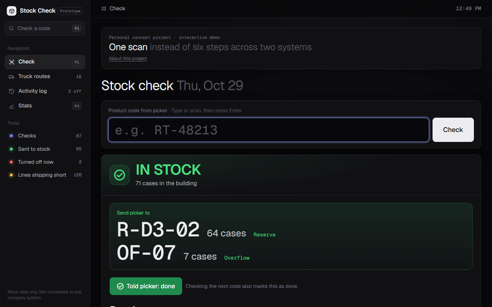
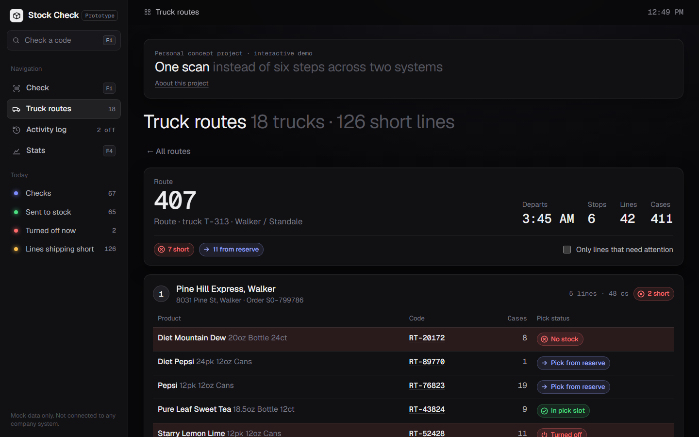

# Stock Check

**One scan instead of six steps across two systems.** A prototype certifier-desk tool for the moment a warehouse picker finds an empty pick slot.

**[▶ Try the live demo](https://benben999-ui.github.io/stock-check/)**. It runs in your browser, with nothing to install.





> **Personal concept project with made-up data.** It does not connect to any real company system, and it is not affiliated with or endorsed by any company. Every product code, route, truck, location and quantity is invented.

## The problem

In a beverage distribution warehouse, pickers fill store orders with voice-pick headsets. When a picker reaches an empty pick slot, they go to a certifier, who has to:

1. Find the product in the route program that drives the headsets
2. Copy its product code
3. Paste that code into a separate inventory website to get a second, internal code
4. Paste the second code into another page of that site to see reserve and overflow stock
5. Tell the picker where to go, **or**
6. Go back to the route program and turn the product off, then have the picker say "empty slot" into their headset

This happens in a heavy burst at the start of every shift, while trucks are on fixed departure schedules.

## What this prototype does

- **One input, one answer.** Scan or type a code and press Enter. The code-to-code lookup and the stock search happen automatically, and the screen shows the product, both codes, tomorrow's routes, and every location with quantities.
- **A clear outcome.** **IN STOCK** shows where to send the picker in very large text. **OUT OF STOCK** gives a "Turn off product" button with a confirm step, then a reminder to tell the picker to say **EMPTY SLOT**, which the certifier marks as done.
- **Truck routes**: every truck leaving tomorrow, with its stops, lines and cases. Click a truck to see each store in delivery order and every line on that store's order, marked **In pick slot**, **Pick from reserve**, **No stock** or **Turned off**. That shows at a glance which stores will get short orders.
- **An activity log** of every check, plus a "turned off right now" list with a **Turn back on** button for when a delivery arrives.
- **Stats** with checks per hour and average time per check, so the start-of-shift spike is visible.

## How it's built

- **Python standard library only**: a small web server (`server.py`) and a SQLite database. There's nothing to `pip install`.
- **A separate data layer**: `data/repository.py` is the only code that touches the database, and the three-step lookup lives there. `data/seed.py` generates the mock data: 50 products, 18 routes with 102 made-up store stops and their orders, pick/reserve/overflow locations, and 3 days of history.
- **Plain HTML, CSS and JavaScript** for the screen (`static/`), with no framework and no build step.
- **The live demo** (`docs/index.html`) runs the same screens with a browser-only copy of the data layer (`demo/demo-backend.js`), built by `build_demo.py`.

---

# Running it on your own Windows computer

To just look around, use the [live demo](https://benben999-ui.github.io/stock-check/). The steps below run the full version with its local database.

**Get the code:** on this GitHub page, click the green **Code** button, choose **Download ZIP**, and unzip it anywhere.

## 1. One-time setup: install Python

The app runs on **Python**, a free program. You only need to install it once.

1. Go to **https://www.python.org/downloads/** and click the big yellow **Download Python** button.
2. Open the file you downloaded.
3. **Important:** on the first screen of the installer, tick the box **"Add python.exe to PATH"**.
4. Click **Install Now** and wait for it to finish.

You don't need to install anything else. The app uses only parts that come with Python.

*Already have Python?* You can skip this step. If `start.bat` says Python was not found, run the installer again and make sure the PATH box is ticked.

## 2. Start the app

1. Double-click **`start.bat`**.
2. A black window opens and your web browser opens the app at **http://localhost:8765**.
3. Leave the black window open while you use the app. **Closing it stops the app.**

The app runs only on your computer. Nothing is sent over the internet.

## 3. Reset the demo data

To start fresh (products turned back on, log back to the original demo history):

1. Double-click **`reset_demo.bat`**.
2. Press **Y** to confirm.
3. If the app is open in your browser, press **F5** to refresh.

You can do this while the app is running.

---

## Using the app

The sidebar on the left lists the four screens and today's counts. On a narrow window it becomes a row of tabs across the top. The keys **F1 to F4** jump between the screens.

### Check (F1)
- The big box is ready for typing as soon as the page opens. Type a code, or scan it with a barcode scanner (most scanners "type" the code and press Enter for you).
- Press **Enter**. The app finds the product in the route program, converts it to the inventory system's code, and checks reserve and overflow, all in one step.
- **IN STOCK** (green, ✓ check-mark icon): the location and case count appear in large text. Tell the picker, then click **Told picker: done**. If you scan the next code instead, the app marks it done for you.
- **OUT OF STOCK** (red, ✕ icon): click **Turn off product**, then confirm. A yellow reminder appears: *"Tell the picker to say EMPTY SLOT in their headset."* When the picker has done it, click **Picker said it: mark done**.
- Tip: you can type only the 5 digits (for example `76823` instead of `RT-76823`).

### Truck Routes (F2)
- Lists every truck leaving tomorrow: route number, truck, area, departure time, stops, lines and cases. The last column flags lines that will **ship short** (no stock, or turned off) and lines that must be **picked from reserve**.
- Search by route, truck or area, or filter by truck type (Route, Bulk, Transport).
- Click a truck to open it. You'll see each store stop in delivery order, with its address and order number, and every product on that store's order with cases and a pick status: ✓ In pick slot, → Pick from reserve, ✕ No stock, ⏻ Turned off.
- Tick **Only lines that need attention** to hide the lines that are fine.
- Click any product code to run a stock check on it. On the Check screen, the route numbers in a result open that route.
- Turning a product off or back on updates every route right away.

### Activity Log (F3)
- **Turned off right now** lists every product that is currently off. Click **Turn back on** when a delivery arrives.
- Below that is every check with its time, product, code, result, what was done, and how long it took. Use the search box to filter.

### Stats (F4)
- Checks per hour for today (glowing line) compared with the average of the previous 3 days (dashed line). Hover over the chart to see exact numbers, or open **Show as table**.
- Tiles show today's total, average time per check, the busiest hour, and how much of the day's work fell in the first two hours of the shift.

---

## Demo codes to try

| Try this code | What happens |
|---|---|
| `RT-76823` | Pepsi 12pk: pick slot empty, **IN STOCK in reserve** (R-D3-02) and overflow |
| `RT-35578` | Brisk 1L: pick slot empty, **IN STOCK in reserve** |
| `RT-45054` | Mug Root Beer 12pk: system shows stock **in the pick slot itself**, so the app asks for a recheck |
| `RT-20172` | Diet Mountain Dew 20oz: **OUT OF STOCK**, so you turn it off |
| `RT-67750` | Diet Pepsi 12pk: **OUT OF STOCK** |
| `RT-95569` | Starry 20oz: **already turned off** earlier today |
| `RT-99999` | **Code not found** |

**Routes test:** open **Truck routes**, click route **407**, and look at the first stop. Click `RT-20172` (No stock) to check it, turn it off, then come back: the line now shows **Turned off**.

---

## Where things are

- `static/`: the screen you see (HTML page, styles, and the browser script).
- `server.py`: receives clicks from the page and asks the data layer for answers.
- `data/repository.py`: the **only** code that reads or writes the database. The three-step lookup (route code → inventory code → stock) lives here.
- `data/seed.py`: creates the made-up demo data.
- `data/stockcheck.db`: the database file. It's created on first start, and deleting it is safe, because the app recreates it with demo data.

## Shareable web demo (for LinkedIn or a portfolio)

There is also a version that runs entirely in a web browser, with no Python and no server. It is meant for people who just want to click around.

- It has the same screens and the same made-up data, plus a short "About this project" intro with one-click example codes.
- Each visitor's clicks are saved only in their own browser. A visitor can press **Reset demo** at any time.
- `docs/index.html` is the complete page. GitHub Pages publishes the `docs` folder as the live demo, and you can also double-click the file to open it.

If you change the app, rebuild the demo so it matches, then commit and push the updated `docs/index.html`:

```
python build_demo.py
```

## Troubleshooting

- **"Python was not found"**: install Python (step 1) and tick **Add python.exe to PATH**.
- **The browser didn't open**: open your browser yourself and go to **http://localhost:8765**.
- **"The app already seems to be running"**: it's already open in another black window. The browser opens to it anyway.
- **Something looks stuck**: close the black window, double-click `start.bat` again, and press F5 in the browser.
